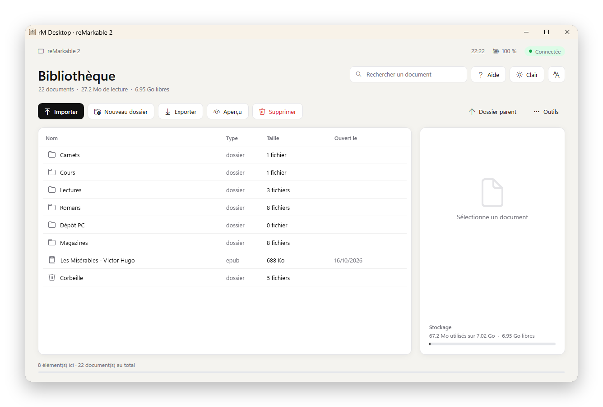
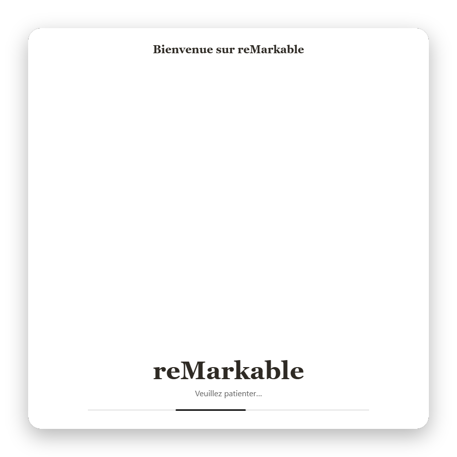
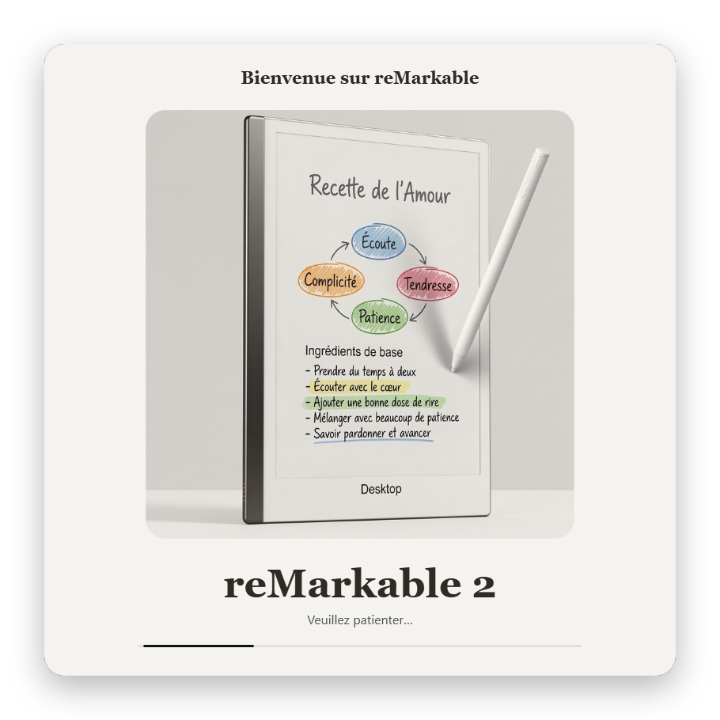
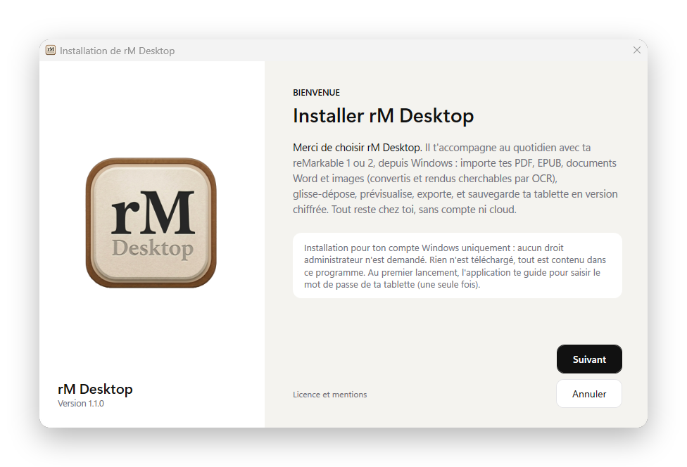

# rM Desktop

Gérez la bibliothèque de votre tablette reMarkable 1 ou 2 depuis Windows ou Linux, par USB.
Aucun compte, aucun cloud, aucune télémétrie : tout reste sur votre PC et votre tablette.

**[Télécharger la dernière version](https://github.com/Gitnmercury/rm-desktop-download/releases/latest)**

Projet indépendant, ni affilié, ni approuvé, ni sponsorisé par reMarkable AS.

## Aperçu

<p align="center">
  <picture>
    <source media="(prefers-color-scheme: dark)" srcset="captures/03-bibliotheque-sombre.png">
    
  </picture>
</p>

<p align="center"><em>La bibliothèque de la tablette, en thème clair ou sombre selon votre réglage GitHub.<br>
Captures réalisées avec des noms de dossiers et de livres d'exemple.</em></p>

<p align="center">
  
  
</p>

<p align="center"><em>Au démarrage : chargement, puis détection de la tablette branchée en USB.</em></p>

<p align="center">
  
</p>

<p align="center"><em>L'assistant d'installation, sans droit administrateur.</em></p>

## Fonctions

- Parcourir la bibliothèque de la tablette, rechercher, prévisualiser.
- Importer PDF, EPUB, Word et images (conversion en PDF et OCR à la demande), par glisser-déposer.
- Exporter, renommer, épingler, supprimer, créer des dossiers.
- Lire les premières pages d'un livre EPUB, sans autre logiciel.
- Ajouter ses propres modèles de page (agenda, quadrillage…) sur la tablette.
- Sauvegarde chiffrée de la tablette.
- Thèmes clair, sombre et automatique.

## Prérequis

- Windows 10 (version 2004 ou plus) ou Windows 11, avec OpenSSH (installé par défaut) ;
  ou Linux avec Python 3.10 ou plus (Ubuntu 22.04, Debian 12 ou plus récent).
- Une reMarkable 1 ou 2, branchée en USB.
- Le mot de passe de la tablette (Réglages > Aide > À propos > Copyrights et licences), saisi une
  seule fois au premier lancement.

## Installation sous Windows

1. Téléchargez `install_remarkable.exe` dans la [dernière version](https://github.com/Gitnmercury/rm-desktop-download/releases/latest).
2. Lancez-le et suivez l'assistant. Aucun droit administrateur n'est demandé, rien n'est téléchargé.

Windows peut afficher « Windows a protégé votre ordinateur » : l'installeur est signé avec un
certificat personnel de l'auteur, que Windows ne connaît pas encore. Cliquez sur « Informations
complémentaires », puis « Exécuter quand même ». Vous pouvez vérifier le fichier avec son
empreinte SHA-256, indiquée dans chaque version.

Désinstallation : menu Démarrer > rM Desktop > Désinstaller, ou Paramètres > Applications.

## Installation sous Linux (Ubuntu, Debian, Linux Mint…)

1. Téléchargez `rm-desktop_<version>_all.deb` dans la [dernière version](https://github.com/Gitnmercury/rm-desktop-download/releases/latest).
2. Dans un terminal, depuis le dossier du téléchargement :

   ```
   sudo apt install ./rm-desktop_*_all.deb
   ```

   `apt` installe aussi ce qui manque (Python, Tkinter, OpenSSH).
3. Lancez « rM Desktop » depuis le menu des applications, ou `rm-desktop` dans un terminal.

Fonctions en option : aperçu des pages PDF (`sudo apt install python3-fitz`), OCR
(`tesseract-ocr tesseract-ocr-fra`), conversion Word (`libreoffice-writer`).

Désinstallation : `sudo apt remove rm-desktop`.

## Licence et confidentialité

Libre d'utilisation, sous réserve, pour les particuliers à titre privé. Ce logiciel ne peut être vendu,
loué, intégré à une offre payante ni redistribué en dehors de cette page sans accord écrit.
Voir [LICENSE.md](LICENSE.md), [PRIVACY.md](PRIVACY.md) et [THIRD-PARTY-NOTICES.md](THIRD-PARTY-NOTICES.md).

Le code source n'est pas publié. Le paquet Linux contient la version Python de l'application sous
forme lisible : la même licence s'y applique.

## Auteur et contact

rM Desktop est créé et maintenu par Anthony BELKACEM, pour son entreprise individuelle
Anthony BELKACEM EI.

Pour les questions générales et le support : [apps@ohtna.fr](mailto:apps@ohtna.fr)

Pour les demandes de licence, d'autorisation d'utilisation, de partenariat ou de prestation :
[licence@ohtna.fr](mailto:licence@ohtna.fr)
